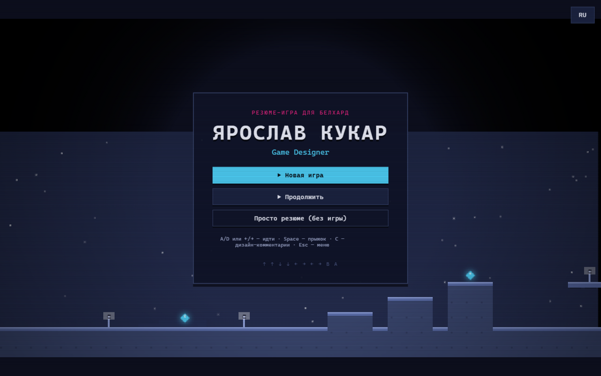
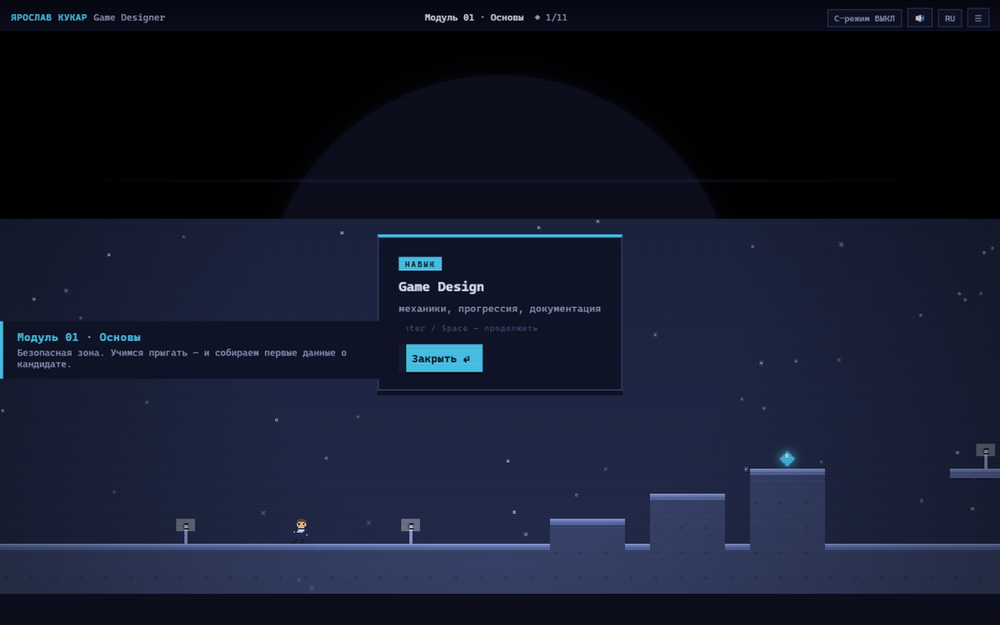
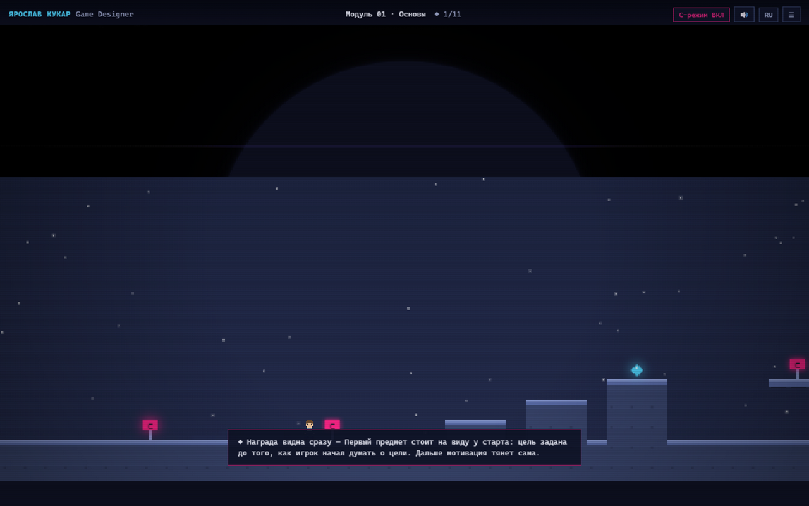
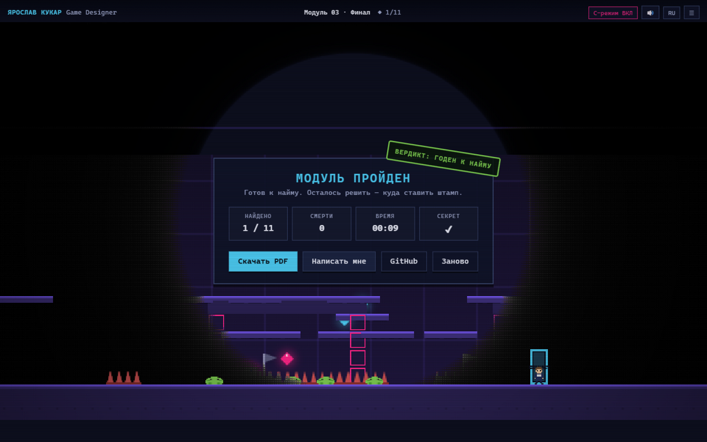
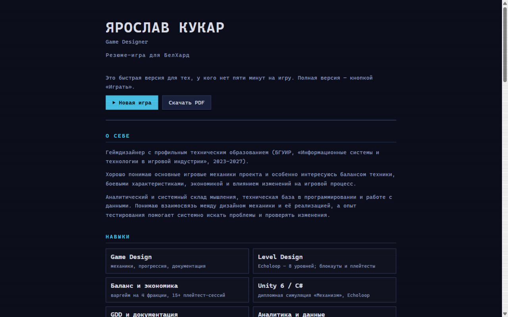

# МОДУЛЬ 01: НАЙМИТЕ МЕНЯ

Моё интерактивное резюме для **БелХард** — не документ, а платформер. Кандидат проходит три «модуля карьеры», собирает навыки и проекты, а геймдизайнерское мышление показывает не список скиллов, а сама игра: в ней встроен режим дизайн-комментарий, объясняющий каждое решение.

Живая версия: **https://kerarty.github.io/cv-belhard/**



## Зачем

Обычное резюме геймдизайнера не показывает, как он думает. Это резюме — само дизайнерское решение: каждый коллектибл несёт реальную информацию о кандидате, геймплей — система доставки, а клавиша **C** включает «дизайн-комментарии» — мета-слой, где игра объясняет собственные механики (coyote time, кривая сложности, честная дверь). Это то, что я умею, показанное, а не рассказанное.

Данные взяты из моего CV (БГУИР, «Информационные системы и технологии в игровой индустрии», 2023–2027).

## Как устроено

Три модуля — три кривые обучения:

- **Модуль 01 · Основы** — безопасная зона: движение, прыжок, первые навыки (Game Design, Level Design, статистика). Ошибка не стоит ничего.
- **Модуль 02 · Проекты** — появляются шипы и патрули: риск после мастерства. Гемы открывают карточки проектов — варгейм «Королевства Эридора» (15+ плейтест-сессий), GDD стратегии, дипломная симуляция «Механизм» на Unity, головоломка Echoloop.
- **Модуль 03 · Финал** — неон, последний набор навыков и секретная комната за иллюзорной стеной. Дверь открыта всегда: собирать всё не обязательно — резюме не гринд.



## Что умеет

- **C — дизайн-комментарии**: таблички в уровнях светятся, при подходе игра объясняет принятое решение. Полный список — в меню и в документе.



- **Fast path для HR**: у рекрутера 60 секунд — кнопка «Просто резюме» сворачивает игру в свёрстанный документ, а тот печатается в PDF (Ctrl+P) одной кнопкой.
- **RU/EN**: весь интерфейс, карточки, дизайн-комментарии и документ переключаются на лету.
- **Сохранение прогресса** в localStorage: собранные гемы, смерти, секрет.
- **Konami-код** (↑↑↓↓←→←→BA): пасхалка для тех, кто дочитал до сюда.
- **Game feel**: coyote time, jump buffer, короткий тап — низкий прыжок, stomp по врагам, частицы, screen shake, чекпоинты.
- **Мобильное управление**: экранные кнопки появляются на тач-устройствах.



## Fast path



## Запуск

Статика без сборки — открыть `index.html` в браузере или на GitHub Pages. Локальный сервер:

```bash
python -m http.server 8123
```

## Технологии

- Vanilla JS + Canvas 2D, ноль зависимостей и сетевых запросов — страница работает офлайн и открывается двойным кликом
- Процедурный пиксель-арт (спрайты рисуются кодом) и звук на WebAudio — без файлов ассетов
- Классические скрипты (не модули) — совместимость с file://
- Fallback-цикл на таймере: игра не встаёт во встроенных превью и фреймах, где rAF задушен

## Структура

```
index.html      — разметка слоёв (сплэш, HUD, карточки, пауза, финал, документ)
css/style.css   — стили игры, документа и печатной версии
js/data.js      — весь контент резюме и локализация RU/EN
js/levels.js    — декларативные уровни + билдер сетки
js/game.js      — движок: физика, рендер, звук, UI
assets/         — скриншоты и оригинальный CV (PDF)
```

## Скриншоты


